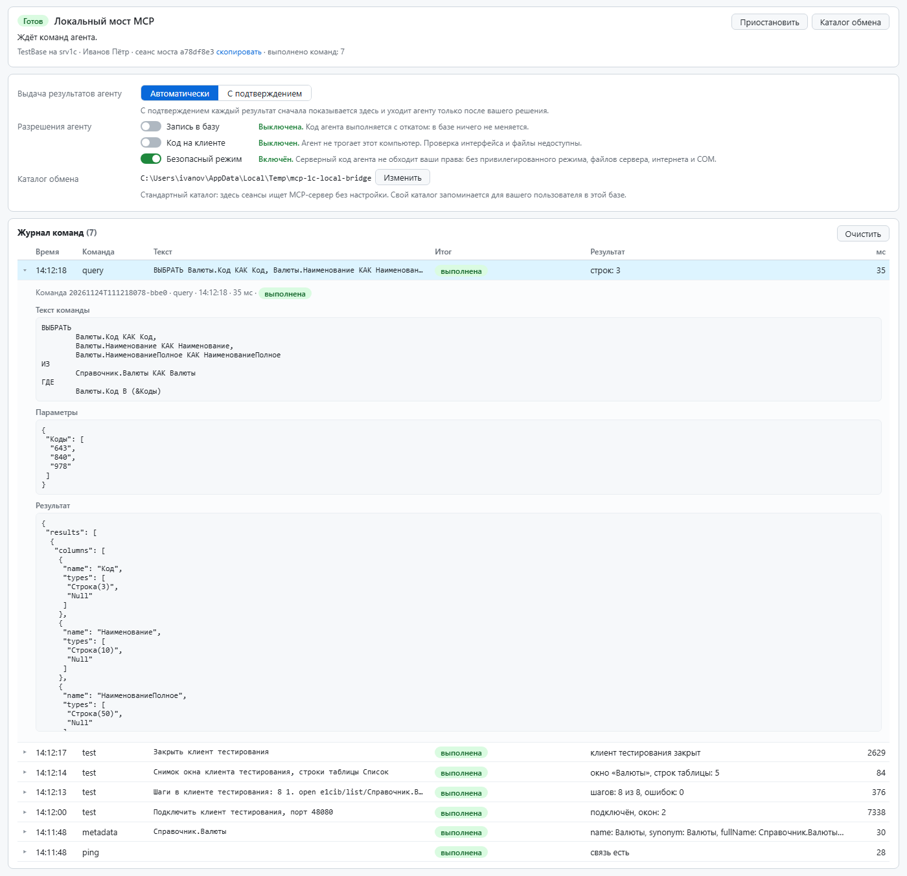
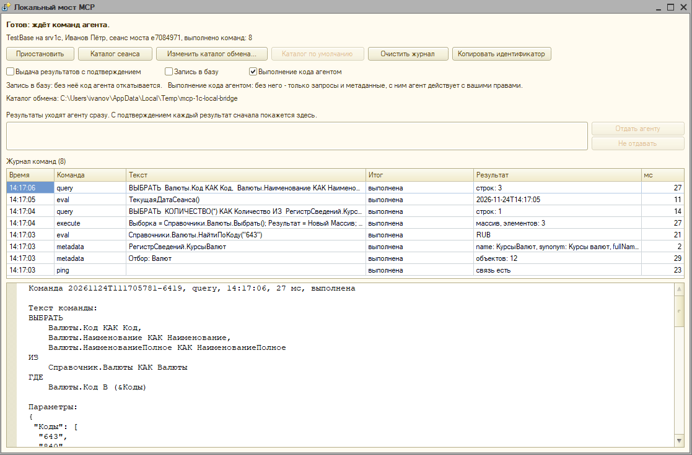

# MCP 1C Local Bridge

MCP-сервер и внешняя обработка 1С, через которые ИИ-агент в любом MCP-клиенте работает с открытым сеансом 1С
пользователя: выполняет запросы, выражения и код, ищет по метаданным, проверяет интерфейс через клиент
тестирования и передаёт файлы. Всё работает на компьютере разработчика: команды и ответы передаются через каталог
в профиле пользователя, промежуточного сервера нет.

[](https://infostart.ru/1c/articles/2831401/)

Статья о проекте на Инфостарте: https://infostart.ru/1c/articles/2831401/

## Что умеет

- **Данные и код.** Запросы с параметрами, `Вычислить` и `Выполнить` на сервере или на клиенте. Серверный код по
  умолчанию идёт в транзакции с откатом; запись - только с разрешения на форме обработки.
- **Метаданные.** Состав конфигурации и описание объекта, поиск по индексу метаданных: где используется тип, кто
  пишет в регистр, подписки и регламентные задания - вместе с объектами расширений.
- **Проверка интерфейса.** Агент запускает клиент тестирования, читает его окна текстом (поля, значения, кнопки,
  таблицы, сообщения, ошибки) и выполняет действия пользователя: открыть форму, ввести и выбрать значения, нажать
  кнопки, добавить строки в табличную часть, ответить на вопросы платформы.
- **Файлы.** Печатная форма в PDF, двоичные данные в файл на компьютере пользователя и файл с компьютера - во
  временное хранилище для серверного кода.
- **Контроль пользователя.** На форме видна каждая команда агента; результаты можно выдавать только после
  подтверждения и с комментарием агенту. Код агента выполняется в безопасном режиме, а переключатели его
  разрешений нажимаете только вы: нажатия из кода агента форма не выполняет.

## Как выглядит

Форма моста в тонком клиенте (управляемая форма): состояние, разрешения агенту, каталог обмена и журнал команд,
строка журнала раскрыта - текст запроса, параметры и результат.



Та же форма в толстом клиенте обычного приложения: журнал таблицей, под ним подробности выбранной команды.



## Как это устроено

```
 MCP-клиент с ИИ-агентом
        | stdio
 MCP-сервер mcp-1c-local-bridge (Python, запускается клиентом на время сессии)
        | файлы JSON
 %TEMP%\mcp-1c-local-bridge\<сеанс>\in, work, out, session.json
        | опрос раз в 0,5 с
 обработка MCPLocalBridge.epf, открытая в клиенте 1С
        | вызов сервера в том же сеансе            | механизм тестирования платформы
 сервер 1С                                          клиент тестирования (второй сеанс)
```

- MCP-сервер кладёт команду файлом в каталог сеанса и ждёт файл ответа.
- Форма обработки раз в полсекунды забирает команды, выполняет их на сервере 1С (или на клиенте) в сеансе
  пользователя и с его правами, пишет ответ и раз в 2 секунды обновляет `session.json` (сердцебиение).
- Обмен идёт на стороне клиента 1С: сервер 1С до компьютера пользователя не достаёт, поэтому каталог - на
  этом компьютере, и данные дальше него не уходят.
- Несколько сессий агента и несколько открытых баз работают одновременно: у каждой открытой формы свой
  каталог сеанса, у каждой команды - свой идентификатор.

## Требования

- Windows с клиентом 1С:Предприятие 8.3: тонкий клиент, а для конфигураций на обычных формах - и толстый
  клиент обычного приложения. Обработка рассчитана на режим совместимости конфигурации от 8.3.14 и не
  использует `Асинх`/`Ждать`; режим совместимости 8.2 - в разделе [Обычное приложение и старые
  конфигурации](#обычное-приложение-и-старые-конфигурации).
- В конфигурации разрешены синхронные вызовы: свойство «Режим использования синхронных вызовов расширений
  платформы и внешних компонент» - «Использовать» или «Использовать с предупреждениями». Обработка работает
  с файлами на клиенте синхронными методами.
- У пользователя есть право открывать внешние обработки.
- Python 3.11+ и [uv](https://docs.astral.sh/uv/). MCP-сервер запускается на том же компьютере, что и клиент 1С:
  в Windows или в WSL.
- Для проверки интерфейса - лицензия на второй сеанс: клиент тестирования - отдельный сеанс той же базы.

## Установка

1. **Получите исходники и зависимости.** В каталоге, где будет жить мост:

   ```bash
   git clone https://github.com/ntappw/mcp-1c-local-bridge.git
   cd mcp-1c-local-bridge
   uv sync
   ```

   `uv sync` создаёт `.venv` и ставит в него MCP-сервер. Запускать его вручную не нужно - это делает MCP-клиент.

2. **Зарегистрируйте сервер в MCP-клиенте.** Сервер работает по stdio, аргументов нет. Команда запуска:

   | Где запускается сервер | Команда |
   | --- | --- |
   | Windows | `<каталог клона>\.venv\Scripts\mcp-1c-local-bridge.exe` |
   | WSL | `<каталог клона>/.venv/bin/mcp-1c-local-bridge` |

   Во многих клиентах настройки - JSON такого вида:

   ```json
   {
     "mcpServers": {
       "1c-local-bridge": {
         "command": "C:\\tools\\mcp-1c-local-bridge\\.venv\\Scripts\\mcp-1c-local-bridge.exe"
       }
     }
   }
   ```

   Перезапустите клиент, чтобы он подхватил сервер.

3. **Откройте обработку в базе.** `dist/MCPLocalBridge.epf` - «Файл - Открыть» (Ctrl+O) в нужной базе. Если база
   спрашивает о безопасности внешней обработки - разрешите открытие.

4. **Проверьте связь.** Попросите агента вызвать `sessions`: в ответе - база, пользователь и разрешения открытой
   формы. Затем `ping` - время сервера 1С и номер сеанса.

Каталог обмена по умолчанию - `%TEMP%\mcp-1c-local-bridge` пользователя Windows, MCP-сервер находит его сам, в том
числе из WSL. Другой каталог - см. [Свой каталог обмена](#свой-каталог-обмена).

### Обновление

```bash
git pull
uv sync
```

Затем перезапустите MCP-клиент и откройте в базе новый `dist/MCPLocalBridge.epf`: версия обработки видна в
`sessions`. Новые инструменты со старой обработкой не работают и прямо сообщают, какая версия нужна.

Узнавать о новых версиях самому не нужно: о вышедшей версии и об устаревшей обработке в базе скажет агент - см.
[Автопоиск обновлений](#автопоиск-обновлений).

## Работа

1. Откройте `dist/MCPLocalBridge.epf` в нужной базе. Форма - HTML-страница: состояние моста, база и пользователь,
   режим выдачи результатов, разрешения агенту и журнал команд. В толстом клиенте обычного приложения
   открывается обычная форма с тем же составом.
2. Агент вызывает `sessions`, видит сеанс и шлёт команды. Пока форма открыта, сеанс жив; закрыли форму -
   каталог сеанса удаляется, команды больше не принимаются. Если мост открыт в нескольких сеансах, подскажите
   агенту нужный по идентификатору сеанса: его копирует в буфер обмена ссылка «скопировать» в шапке формы, в
   обычной форме - кнопка «Копировать идентификатор».
3. В журнале по каждой команде видны время, вид, текст, итог, краткий результат и длительность. Строка
   раскрывается щелчком прямо в списке: полный текст команды, параметры, результат, сообщения и ошибка.
   Раскрытые строки и прокрутка не сбрасываются, когда приходят новые команды. Журнал хранит последние 50
   команд: если их было больше, у заголовка журнала видно «50 из N», где N - все команды сеанса моста.
4. «Приостановить» останавливает выполнение: команды ждут в очереди. При открытии формы «Запись в базу» и
   «Код на клиенте» выключены, «Безопасный режим» включён; переключаются они одним щелчком, без вопросов. Что они
   значат - в разделе [Безопасность и ограничения](#безопасность-и-ограничения). В обычной форме разрешений два -
   «Запись в базу» и «Выполнение кода агентом»: там и серверный код агента выполняется в процессе клиента.

### Примеры просьб агенту

- «Сколько документов РеализацияТоваровУслуг за ноябрь по каждой организации?» - `query`.
- «Где используется справочник ДоговорыКонтрагентов и какие документы пишут в регистр Взаиморасчеты?» -
  `find`, `usages`.
- «Проведи документ с номером 000123 без сохранения и покажи движения» - `execute`: проведение идёт в транзакции с
  откатом, база не меняется.
- «Сохрани печатную форму счёта 000123 в PDF на рабочий стол» - `save_file`.
- «Проверь форму нового заказа: каждое поле шапки, табличную часть, кнопку Записать» - `test_connect`,
  `test_snapshot`, `test_steps`.

### Выдача результатов

- **Автоматически** (по умолчанию) - ответ уходит агенту сразу после выполнения команды.
- **С подтверждением** - выполненная команда показывается на форме вместе с результатом, и агент получает его
  только после кнопки «Отдать агенту». «Не отдавать» возвращает агенту статус `denied` без данных. Пока
  результат ждёт решения, следующие команды стоят в очереди. Вызов агента, не дождавшийся решения за
  `timeout`, сообщает, что результат ждёт пользователя, и забирает ответ позже инструментом `result`.

  К решению можно приложить комментарий агенту: при отказе - почему результат не отдан и что исправить в
  запросе, при выдаче - что учесть в результате. Агент получает комментарий вместе с ответом и может сразу
  прислать исправленный запрос. Разрешений на форме комментарий не меняет.

### Свой каталог обмена

По умолчанию обработка и MCP-сервер работают в `%TEMP%\mcp-1c-local-bridge` пользователя Windows, и
настраивать ничего не нужно. Другой каталог можно задать, например, если `%TEMP%` чистится или его проверяет
антивирус. Сами стороны каталог не согласуют, поэтому он задаётся в двух местах:

1. В обработке: в строке «Каталог обмена» нажмите «Изменить» и выберите каталог. Сеанс сразу переезжает в
   него с новым идентификатором, а выбор запоминается для пользователя 1С в этой базе и действует при следующих
   открытиях. Пока каталог не стандартный, форма напоминает, что MCP-серверу нужен тот же. «По умолчанию»
   возвращает стандартный каталог.
2. MCP-серверу: тот же каталог в переменной окружения `MCP_1C_BRIDGE_DIR` - путём, под которым каталог виден
   процессу MCP-сервера. Переменную задают в настройках сервера в MCP-клиенте, обычно в поле `env`:

   ```json
   "1c-local-bridge": {
     "command": "C:\\tools\\mcp-1c-local-bridge\\.venv\\Scripts\\mcp-1c-local-bridge.exe",
     "env": {"MCP_1C_BRIDGE_DIR": "D:\\mcp\\exchange"}
   }
   ```

   После изменения перезапустите клиент. Проверка - инструмент `sessions`: в нём виден сеанс, а если сеансов
   нет - каталог, где их ищет MCP-сервер.

Чтобы вернуться к стандартному каталогу, нажмите «По умолчанию» в обработке и уберите переменную из настроек
MCP-сервера.

Клиент 1С на терминальном сервере (RDP): `%TEMP%` там серверный, и MCP-сервер на вашем компьютере его не
видит. Выберите в обработке каталог на диске своего компьютера, проброшенном в сеанс RDP («Локальные ресурсы -
Диски» в настройках подключения), например `\\tsclient\C\mcp-exchange`, а в `MCP_1C_BRIDGE_DIR` - тот же
каталог локально: `C:\mcp-exchange`. Код агента с `side=client` выполняется при этом на терминальном сервере:
файлы, которые он пишет, остаются там, а не на вашем компьютере.

- MCP-сервер смотрит в один каталог. Если в разных базах выбраны разные каталоги, агент видит сеансы только из
  каталога MCP-сервера.
- Каталог должен быть доступен и клиенту 1С, и MCP-серверу.
- В каталоге обмена MCP-сервер трогает только папки сеансов (имя из 8 шестнадцатеричных символов) и пишет
  файл `.clock`, остальное содержимое не меняет.

## Инструменты

| Инструмент | Что делает |
| --- | --- |
| `sessions` | Открытые сеансы моста: база, пользователь, конфигурация, режим совместимости, состояние, разрешения |
| `ping` | Проверка связи: время сервера 1С, номер сеанса, пользователь |
| `query` | Запрос 1С с параметрами; возвращает все результаты пакета, `row_limit` строк каждого |
| `eval` | `Вычислить(<выражение>)` на сервере или на клиенте |
| `execute` | `Выполнить(<код>)`; результат - значение переменной `Результат` |
| `metadata` | Состав конфигурации с отбором или описание объекта по полному имени, включая объекты расширений |
| `find` | Поиск по индексу метаданных: объекты, реквизиты, измерения, табличные части, значения перечислений, подписки и задания - по имени, синониму, обработчику |
| `usages` | Где используется объект: поля его типа, движения, подписки, планы обмена, подсистемы, функциональные опции и другие связи из метаданных |
| `test_connect` | Запустить клиент тестирования и подключиться к нему (или подключиться к уже запущенному) |
| `test_snapshot` | Окно клиента тестирования текстом: элементы формы с именами и значениями, таблицы, сообщения, ошибки |
| `test_steps` | Действия пользователя в клиенте тестирования пачкой, с итогом каждого шага |
| `test_close` | Закрыть клиент тестирования |
| `save_file` | Значение с сервера 1С (печатная форма, двоичные данные, текст) - в файл на компьютере пользователя |
| `load_file` | Файл с компьютера пользователя - во временное хранилище 1С для серверного кода |
| `result` | Результат команды, не уложившейся в `timeout` |
| `cancel` | Снять команду, которую обработка ещё не начала |

У команд есть `session` (идентификатор или часть строки соединения; не нужен, если сеанс один) и `timeout`
(до 280 с). Команда, которую обработка не начала за `timeout`, снимается и уже не выполнится; начатая
выполняется дальше, а вызов возвращает её идентификатор для `result`. Ответ больше 20 000 символов
сохраняется в `~/.cache/mcp-1c-local-bridge/results/`, в ответ инструмента попадают начало и пути к файлам.

Инструменты, которые ничего не меняют (`sessions`, `ping`, `query`, `metadata`, `find`, `usages`, `result`),
помечены для MCP-клиента как только читающие: клиенты, которые это учитывают, вызывают их одновременно, в том числе
в разных сеансах моста.

### Проверка интерфейса

Инструменты `test_*` работают через механизм автоматизированного тестирования платформы. Нужно:

1. Запустить 1С с ключом `/TESTMANAGER` (в ярлыке или в строке запуска) и открыть в этом сеансе обработку моста. На
   форме включить «Код на клиенте»; выдача результатов - «Автоматически».
2. `test_connect` запускает клиент тестирования: второй сеанс той же базы под тем же пользователем с ключами
   `/TESTCLIENT -TPort 48000`. Пока он стартует, окно 1С отвечает. Уже запущенный клиент мост просто подключает.
3. `test_snapshot` показывает окно текстом - так агент узнаёт имена элементов:

   ```
   Окно «Заказ клиента (создание) *»
     Форма Документ.ЗаказКлиента.Форма.ФормаДокумента «Заказ клиента (создание)» [изменена]
       [группа] ГруппаШапка «Шапка»
         Организация (Поле ввода) = "Ромашка ООО"
         Склад (Поле ввода) = ""
       [кнопка] ФормаЗаписать «Записать»
       [таблица] Товары «Товары»
         ТоварыНоменклатура «Номенклатура» (Поле ввода)
         ТоварыКоличество «Количество» (Поле ввода)
         текущая строка: ТоварыНоменклатура="Сахар"; ТоварыКоличество="5"
   Сообщения пользователю в окнах клиента:
   - Не заполнено поле "Склад"
   Окна: «Главное» (основное), «Заказ клиента (создание) *» (активное)
   ```

4. `test_steps` выполняет шаги и по каждому сообщает итог, смену окна, новые сообщения и ошибки клиента:

   ```json
   [
     {"action": "open", "value": "e1cib/list/Документ.ЗаказКлиента"},
     {"action": "click", "target": "ФормаСоздать"},
     {"action": "wait_window", "value": "Заказ клиента (создание)*"},
     {"action": "select", "target": "Организация", "value": "Ромашка"},
     {"action": "add_row", "target": "Товары"},
     {"action": "select", "target": "ТоварыНоменклатура", "value": "Сахар"},
     {"action": "input", "target": "ТоварыКоличество", "value": "5"},
     {"action": "end_row", "target": "Товары"},
     {"action": "click", "target": "ФормаЗаписать"}
   ]
   ```

   ```
   Шаги: выполнено 9 из 9, с ошибкой 0
   1. + open  -> окно «Заказы клиентов»
   2. + click ФормаСоздать  -> окно «Заказ клиента (создание)»
   ...
   9. + click ФормаЗаписать  -> окно «Заказ клиента 000000012 от 24.11.2026»
   ```

   Действия: `open` (навигационная ссылка), `wait_window`, `close`, `click`, `activate`, `input`, `select` (из
   списка выбора или ввод по строке у ссылки), `choose` (форма выбора), `clear`, `check`, `read`, `expect`
   (сверка значения), `add_row`, `edit_row`, `end_row`, `delete_row`, `choose_row`, `goto_row`. Чего шаги не
   умеют, агент делает кодом `execute` с `side=client`: подключённое приложение там - переменная
   `КлиентТестирования`.
5. `test_close` закрывает клиент. Окна с несохранёнными изменениями он не закрывает вслепую: их закрывают шагами.

Что учитывать:

- Действия в клиенте тестирования - действия пользователя в отдельном сеансе: записанное и проведённое ими
  сохраняется в базе, отката нет, разрешение «Запись в базу» на них не действует. Проверяйте в тестовой базе.
- Механизм тестирования видит управляемые формы. Обычные формы он не видит - их агент проверяет кодом.
- Вопрос платформы («Данные были изменены. Сохранить изменения?») - окно с формой `MessageBox`: снимок показывает
  его текст и кнопки `Button0`, `Button1`... с заголовками, нажимать можно по заголовку («Нет»). Меню
  `ПоказатьВыборИзМеню` и подменю тестовым API не выбираются.
- Каждый шаг - вызов клиента тестирования и время окна 1С пользователя: 15-20 шагов ввода - до 20 секунд.
- Если клиент запущен, а `test_connect` не подключается («клиент тестирования не показал ни одного окна»), сеанс
  менеджера мог запомнить прежний, уже закрытый клиент на этом порту - помогает другой `port`.

### Файлы

`save_file` вычисляет выражение на сервере в транзакции с откатом и пишет значение в файл на компьютере
пользователя. Документ можно провести или изменить ради печати - в базе это не сохранится:

```
save_file(expression="ПолучитьИзВременногоХранилища(<адрес>)", path="C:\Users\me\Desktop\счёт.pdf")
```

Значение - двоичные данные, табличный документ (формат по расширению: `pdf`, `mxl`, `xlsx`, `docx`...),
текстовый документ, картинка, строка, хранилище значения или адрес временного хранилища. Без `path` файл ложится
в каталог сеанса моста и удаляется вместе с ним. Пути WSL MCP-сервер переводит в пути Windows сам.

`load_file` кладёт файл с компьютера во временное хранилище и возвращает адрес: серверный код следующих команд
читает его `ПолучитьИзВременногоХранилища(<адрес>)`. Обе команды выполняет клиент 1С: нужен «Код на клиенте»
и автоматическая выдача результатов.

### Индекс метаданных

`find` и `usages` работают по индексу метаданных сеанса: объекты конфигурации и активных расширений, их поля с
типами, движения, подписки, регламентные задания, составы планов обмена, подсистем, функциональных опций, общих
реквизитов. Первый вызов в сеансе моста просит индекс у обработки, дальше поиск идёт в памяти MCP-сервера и окно
1С не занимает.

Обработка хранит индекс в настройках пользователя этой базы и отдаёт оттуда, пока метаданные те же: версия
конфигурации и расширения, состав объектов и число их полей. Иначе индекс строится заново - порциями до секунды,
между которыми окно 1С отвечает; на форме виден процент. Построение дольше `timeout` не теряется: вызов
сообщает, что индекс строится, повторный ждёт ту же команду. Смену типа или переименование поля без изменения их
числа обработка не замечает: после загрузки таких изменений в базу передайте `refresh=true`.

На конфигурации больше 10000 объектов метаданных (типовые БП, ERP, КА) построение идёт минуты и всё это время
нагружает сеанс пользователя и рабочий процесс сервера. Поэтому там обработка строит индекс только по вызову с
`build=true`, а без него отвечает отказом: агенту велено сначала спросить пользователя. Готовый сохранённый
индекс отдаётся и без `build`. На общих серверах (копии рабочих баз, препрод) вместо индекса лучше точечный
`metadata`.

Кода модулей в индексе нет: из режима Предприятия тексты модулей недоступны, обращения из кода ищутся по
выгрузке конфигурации.

### Значения

Ответ обработки - JSON. Ссылка приходит объектом `{"_type": "Справочник.Контрагенты", "_uuid": "...",
"_presentation": "..."}`, значение перечисления - `{"_type": "Перечисление.X", "_name": "...", ...}`,
дата - строкой `2026-10-21T00:00:00`, `NULL` и `Неопределено` - `null`. Таблица значений, результат запроса
и набор записей регистра - колонками и строками (не больше `row_limit`, по умолчанию 1000), объект
справочника или документа - реквизитами и табличными частями. В формате `table` ссылки показываются
представлениями, в `json` - целиком.

Параметры `query` - объект «имя: значение». Простые значения передаются как есть, массив - списком для
`В (&Список)`, особые значения - объектами:

| Объект | Значение 1С |
| --- | --- |
| `{"_date": "2026-10-21"}` | дата (можно с временем) |
| `{"_type": "Справочник.Контрагенты", "_uuid": "..."}` | ссылка; ссылку из ответа можно передать целиком |
| `{"_type": "Перечисление.ВидыКонтрагентов", "_name": "ЮридическоеЛицо"}` | значение перечисления |
| `{"_predefined": "Справочник.Валюты.Рубль"}` | предопределённое значение |
| `{"_expr": "НачалоГода(ТекущаяДатаСеанса())"}` | выражение, вычисленное на сервере |

Пример кода для `execute`:

```bsl
Выборка = Справочники.Валюты.Выбрать();
Результат = Новый Массив;
Пока Выборка.Следующий() Цикл
	Результат.Добавить(Выборка.Ссылка);
КонецЦикла;
```

Клиентский код (`side=client`) выполняется в модуле служебной формы обработки, поэтому его переменные не должны
совпадать с именами свойств формы (`Окно`, `Элементы`, `Заголовок`): такой код MCP-сервер не отправляет и
называет конфликтующие имена.

## Обычное приложение и старые конфигурации

Конфигурации на обычных формах (УТ 10.3, БП 2.0, УПП, КА 1.1) подключаются двумя способами:

- В тонком клиенте: конфигурация открывается в режиме управляемого приложения, и мост работает как обычно,
  в том числе в режиме совместимости 8.2.
- В толстом клиенте обычного приложения - в том же сеансе, где работает пользователь. Толстый клиент открывает
  у обработки её обычную форму: тот же мост на стандартных элементах - состояние, кнопки, флажки режима выдачи
  и разрешений, журнал команд таблицей и под ним подробности выбранной команды. Команды, выдача с
  подтверждением и комментарием, свой каталог обмена, индекс метаданных и файлы работают так же, как в
  управляемой форме; `sessions` показывает у такого сеанса «обычное приложение». Серверный код агента выполняет
  модуль объекта обработки в том же процессе толстого клиента, с тем же откатом транзакции. Отличия от тонкого
  клиента:
  - сообщения `Сообщить()` толстый клиент сразу выводит в окно сообщений 1С, агенту в ответе они не приходят;
  - код на клиенте (`side=client`) работает в толстом клиенте с полным доступом к базе, без транзакции и
    отката: запись из него флажок «Запись в базу» не останавливает;
  - безопасного режима в толстом клиенте нет: любой код агента, в том числе «серверный» `eval`/`execute` и
    выражения `_expr` в параметрах запроса, выполняется в процессе клиента и может работать с файлами и
    программами компьютера. Поэтому весь код здесь под одним разрешением «Выполнение кода агентом» (выключено при открытии,
    включается с подтверждением); без него работают запросы, метаданные и индекс;
  - выбор каталога обмена и предупреждения - модальные окна: пока такое окно открыто, команды не выполняются;
  - проверка интерфейса работает и здесь: клиент тестирования запускается толстым клиентом обычного приложения и
    видит открытые в нём управляемые формы; обычные формы механизм тестирования не видит. Основного окна у такого
    клиента механизм не показывает, поэтому `test_close` только разрывает соединение - клиент закрывают вручную.

## Безопасность и ограничения

Мост выполняет код агента в вашем сеансе 1С. Что ограничивает агента на самом деле, а что только страхует от
случайностей:

| Защита | Что даёт | Насколько надёжна |
| --- | --- | --- |
| Права пользователя 1С | Агент видит и меняет только то, что разрешено вам | Надёжна, пока включён безопасный режим |
| Безопасный режим (включён при открытии формы) | Серверный код агента не может включить привилегированный режим и обойти права и RLS, работать с файлами сервера, интернетом, COM и внешними компонентами | Надёжна: режим устанавливает обработка, вложенный код снять его не может |
| Откат транзакции при выключенной «Записи в базу» | Проверочный код ничего не сохраняет | Страховка: код может сам завершить транзакцию. Мост это замечает - не отдаёт результат, приостанавливается и ждёт вас, - но записанное до этого остаётся. Фоновое задание, запущенное кодом, пишет в своём сеансе, и мост его не видит |
| «Код на клиенте» выключен (так при открытии формы) | Агент не трогает файлы и программы вашего компьютера и не управляет клиентом тестирования | Надёжна |
| Выдача результатов с подтверждением | Вы видите каждый результат до агента | Надёжна: код на клиенте, проверка интерфейса и файлы в этом режиме не выполняются |
| Переключатели нажимаете только вы | Код агента не может сам включить себе запись, код на клиенте, выключить безопасный режим или подтверждение результатов: нажатие из скрипта страницы форма отбрасывает, служебные процедуры формы коду агента недоступны | Надёжна внутри 1С. Программа, запущенная клиентским кодом на компьютере, может нажать переключатель как человек. Если версия 1С не сообщает, кто нажал, при включённом «Коде на клиенте» права не расширяются: сначала выключите его |

Что важно понимать:

- **Главное решение - включать ли «Код на клиенте».** Пока он выключен, все ограничения выше держатся. Когда он
  включён, агент действует с вашими правами на этом компьютере: внутри 1С он переключателей не нажмёт, но
  программа, которую он запустит, сможет. Разрешение не запоминается: при открытии формы оно выключено. Выключение
  «Кода на клиенте» перерисовывает страницу формы и сбрасывает служебную форму; если агент мог запускать
  программы, надёжнее закрыть форму моста и сеанс 1С.
- **«Код на клиенте» - это ваши права без отката.** Такой код работает с файлами компьютера, запускает программы,
  вызывает серверные методы конфигурации (их запись не откатывается и тумблером «Запись в базу» не ограничена),
  а через клиент тестирования действует как пользователь: записывает и проводит документы. Он выполняется в
  отдельной служебной форме и не видит разрешений и журнала моста, но страница формы моста ему доступна через
  окна клиента: показанное в журнале он может исказить. Включайте в тестовых базах и для задач, где это нужно.
  В толстом клиенте обычного приложения такой код выполняется с прямым доступом к базе.
- **Безопасный режим мешает части законных задач**: HTTP-запрос с сервера, чтение файла сервера, внешняя
  компонента. Тогда агент получает ошибку «Установлен безопасный режим» и просит вас выключить режим на форме.
- **Данные базы могут содержать текст, похожий на указания агенту** (комментарий документа, наименование).
  Агенту велено не выполнять такие инструкции, но гарантии здесь нет: для чужих и непроверенных данных
  включайте выдачу с подтверждением и не включайте запись.
- Код агента выполняется в живом сеансе пользователя. Пока команда идёт, окно 1С не отвечает; ошибка платформы
  в такой команде может уронить сеанс. Долгую операцию (обмен, массовую обработку) агенту подсказано запускать
  не одним `execute`, а фоновым заданием через экспортный метод общего модуля конфигурации - только с
  `allow_write=true` и с вашего согласия.
- Откат не отменяет внешних эффектов: файлов, HTTP-запросов, почты, запуска фоновых заданий, записей журнала
  регистрации.
- Запись (`allow_write=true` и включённая «Запись в базу») тоже идёт в транзакции: изменения фиксируются, только
  если код отработал без ошибок. Если код оставил незавершённую свою транзакцию или перехватил ошибку записи
  внутри неё, запись не фиксируется. `transaction=false` выполняет запись без транзакции моста: что код успел
  записать до ошибки, остаётся. Это нужно долгим операциям и коду, который сам управляет транзакциями.
- `save_file` пишет файлы туда, куда укажет агент, с правами пользователя Windows; существующий файл
  перезаписывается.
- Каталог обмена лежит в профиле пользователя Windows (`%TEMP%`). Команду в него может положить любой процесс
  под этой учётной записью - тот же уровень доверия, что и у самого сеанса 1С. Свой каталог выбирайте с такими же
  правами: в общую папку команду сможет положить любой, у кого есть запись туда, и она выполнится в вашем сеансе.
  Проверки на стороне MCP-сервера (например, имён переменных клиентского кода) - удобство, а не защита: границу
  держит обработка.
- Если на экране модальное окно 1С (например, ошибка компиляции вызванного модуля), обработка не выполняет
  команды, пока окно не закроют. `sessions` показывает такой сеанс как неотвечающий.
- Если MCP-клиент умеет подтверждать вызовы инструментов, не разрешайте `execute`, `eval`, `test_steps` и
  `save_file` без вопроса: пусть каждый их вызов подтверждается вручную.

## Сборка обработки

Исходники обработки - XML-выгрузка в `epf/`, собранный файл - `dist/MCPLocalBridge.epf`. Сборке нужна
лицензия 1С, поэтому скрипт подключает конфигуратор к серверной базе (лучше тестовой или копии); в базу
ничего не загружается:

```powershell
powershell -NoProfile -ExecutionPolicy Bypass -File scripts\build-epf.ps1 -Server <сервер> -Ref <база>
```

Модули `.bsl` хранятся в UTF-8 с BOM и переводами строк CRLF, как их выгружает конфигуратор.

Обычная форма `ФормаОбычная` в выгрузке - двоичный контейнер `Form.bin`. Её модуль и макет лежат текстом в
`epf/ordinary-form`. Проверка интерфейса и файлы написаны один раз - в модуле управляемой формы, в областях
`ТестированиеИнтерфейса` и `ОбменФайлами`; в модуль обычной формы их переносит `python3
scripts/sync_ordinary_form.py`, он же пересобирает `Form.bin`. После правки только обычной формы контейнер
пересобирается командой `python3 scripts/pack_ordinary_form.py`. Тесты проверяют, что `Form.bin` собран из
текущих исходников и общие области не разошлись.

## Протокол

Формат каталога обмена, команд и ответов - [docs/protocol.md](docs/protocol.md).

## Разработка

```bash
uv run pytest
```

Тесты проверяют MCP-сторону с имитацией обработки в отдельном потоке. Сборка не проверяет компиляцию модулей:
собранный файл подключите в тестовой базе и откройте обе формы - управляемую в тонком клиенте и обычную в
толстом клиенте обычного приложения, затем прогоните `ping`, `query`, `eval`, `execute`, `metadata`, `find`,
инструменты `test_*` и файлы.

## Автопоиск обновлений

MCP-сервер раз в сутки проверяет, не вышла ли новая версия моста, и сообщает об этом в ответе `sessions`, а агент
передаёт вам: что вышло, где посмотреть и как обновиться. Там же - предупреждение, если в базе открыта обработка
другой версии, чем MCP-сервер.

Как это работает: сервер выполняет `git ls-remote --tags origin` в папке своего клона и сравнивает теги `vX.Y.Z`
с установленной версией. Проверка идёт в фоне и не задерживает инструменты; результат хранится сутки в
`~/.cache/mcp-1c-local-bridge/update-check.json`. Без сети или доступа она молча пропускается.

Чтобы проверка работала, нужно:

- MCP-сервер версии 1.6.0 или новее: в 1.5.1 и раньше проверки нет, о выходе 1.6.0 она не сообщит;
- установка через `git clone` - у скачанного архива нет папки `.git`, проверять нечего;
- `git` доступен процессу MCP-сервера (в `PATH` той системы, где он запущен: Windows или WSL);
- доступ к репозиторию без ввода пароля - SSH-ключ или сохранённые учётные данные, как для `git pull`: в фоне
  проверка пароль не спрашивает;
- сеть до репозитория;
- переменная окружения `MCP_1C_BRIDGE_UPDATE_CHECK` не равна `0` - так проверка выключается.

Кроме того, можно подписаться на релизы в самом репозитории: на GitHub - Watch, Custom, Releases; в GitLab -
уведомления проекта, событие New release.

## Лицензия

[MIT](LICENSE)
